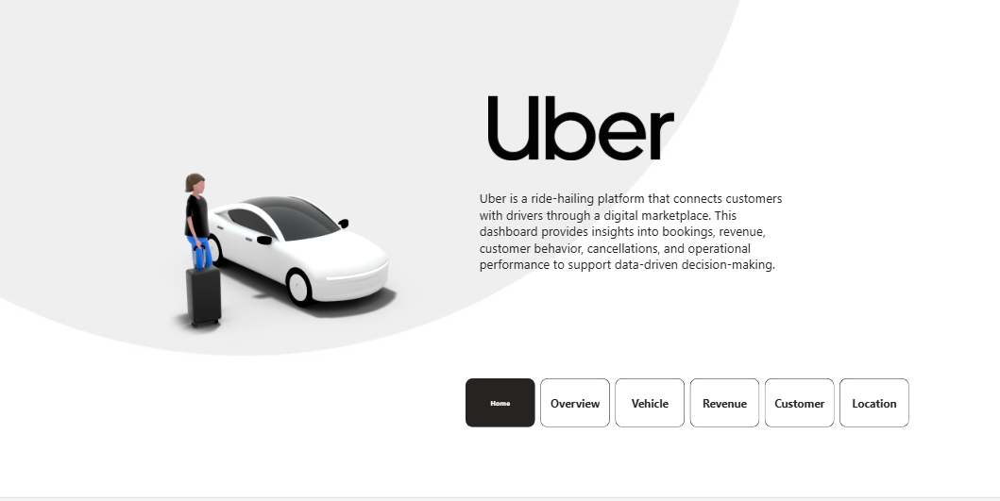
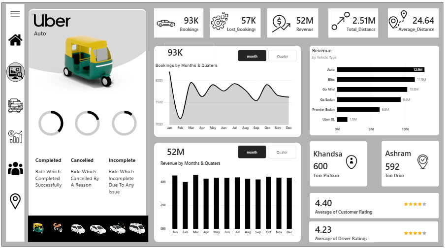
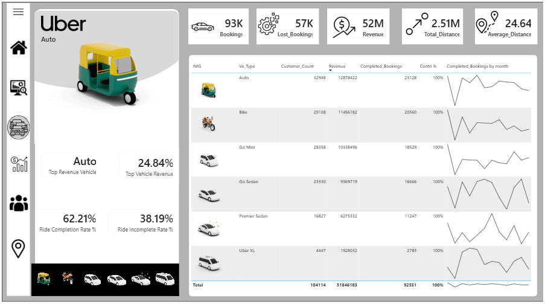
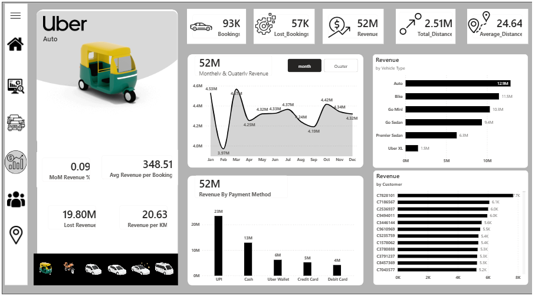
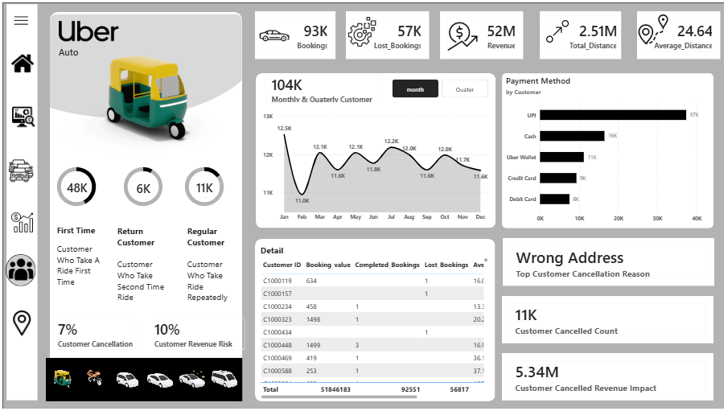
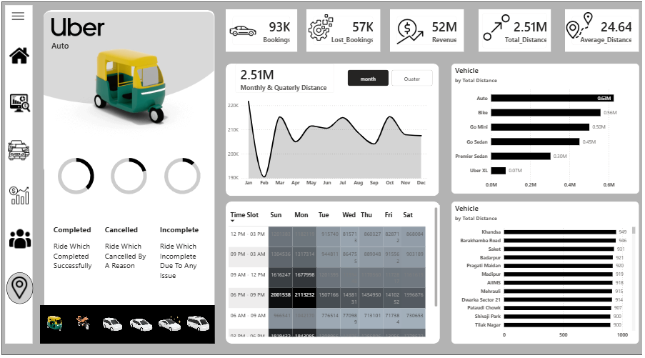
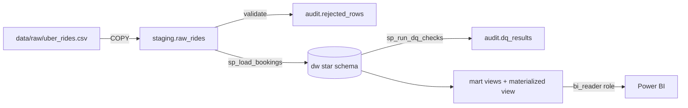

#  Uber Power BI Dashboard – Business Analytics Project

An end-to-end **Power BI analytics dashboard** designed to analyze Uber ride data and deliver actionable insights across **bookings, revenue, vehicles, customers, and locations**.  
This project focuses on **business-driven analytics**, data modeling, DAX calculations, and professional dashboard design.

---

##  Live Dashboard  
[Click here to view the Power BI report](https://app.fabric.microsoft.com/view?r=eyJrIjoiMWM3NDhiOWItNWZhNi00ODc2LTg1MjQtYmM2Y2Y5ODM1MTJkIiwidCI6ImY5YTQzODQwLWY3OGUtNDE3Yy05ZDgwLTg5NTJhMmJhN2Y0YiJ9)


---

##  Project Overview

Uber operates at a large scale with thousands of daily rides. Managing such operations requires transforming raw ride data into **meaningful insights** that support decision-making.  
This project addresses key business questions related to **performance monitoring, revenue optimization, customer behavior, and operational efficiency** using Microsoft Power BI.

---

##  Business Objectives

- Monitor overall ride and revenue performance
- Identify revenue drivers and loss areas
- Analyze vehicle-wise contribution and efficiency
- Understand customer behavior and cancellation impact
- Identify peak demand locations and time slots
- Enable data-driven operational and strategic decisions

---

##  Dataset Overview

The dataset represents **ride-level transactional data** and includes:

- Booking details (Booking ID, Status, Value)
- Vehicle types (Auto, Bike, Sedan, XL, etc.)
- Customer information
- Pickup and drop locations
- Distance traveled
- Time and date attributes
- Ratings and cancellation reasons

Data is analyzed on **monthly and quarterly** levels to identify trends and patterns.

---

##  Dashboard Architecture

The dashboard is structured into **five analytical pages**, each serving a specific business requirement:

1. Overview  
2. Vehicle  
3. Revenue  
4. Customer  
5. Location  

Interactive navigation buttons and filters allow seamless movement between pages.

---

## Page-wise Business Explanation

---

### 1️ Home / Landing Page

**Purpose**
- Introduces the Uber analytics dashboard
- Provides context and navigation for users

**Key Features**
- Uber branding and visual identity
- Brief description of dashboard purpose
- Navigation buttons to all analytical pages

**Business Value**
- Improves user experience
- Makes the dashboard portfolio and stakeholder-ready

---


---

### 2️ Overview Page

**Business Requirement**
Provide a high-level snapshot of Uber’s operational and financial performance.

**KPIs Displayed**
- Total Bookings
- Lost Bookings
- Total Revenue
- Total Distance
- Average Distance per Ride

**Insights Provided**
- Monthly and quarterly booking trends
- Revenue trends over time
- Revenue by vehicle type
- Top pickup and drop locations
- Average customer and driver ratings

**Business Value**
- Enables quick executive-level decision-making
- Identifies overall growth, decline, or inefficiencies

---


---

### 3️ Vehicle Page

**Business Requirement**
Analyze performance at the vehicle level to optimize fleet usage.

**Key Metrics**
- Booking count by vehicle
- Revenue by vehicle type
- Revenue contribution percentage
- Ride completion rate
- Ride incomplete rate

**Insights Provided**
- Identification of top revenue-generating vehicles
- Comparison of completion efficiency across vehicle types
- Sparkline trends for completed bookings

**Business Value**
- Supports fleet optimization
- Helps improve pricing and incentive strategies

---


---
### 4️ Revenue Page

**Business Requirement**
Provide detailed financial insights and identify revenue risks.

**Key Analysis**
- Monthly and quarterly revenue trends
- Revenue by vehicle type
- Revenue by payment method (UPI, Cash, Wallet, Cards)
- Revenue by top customers

**Efficiency & Risk Metrics**
- Month-on-Month revenue change
- Average revenue per booking
- Revenue per kilometer
- Lost revenue estimation

**Business Value**
- Identifies profitable segments
- Detects revenue leakage
- Supports financial planning and strategy

---


---

### 5️ Customer Page

**Business Requirement**
Understand customer behavior, loyalty, and cancellation impact.

**Customer Segmentation**
- First-time customers
- Returning customers
- Regular customers

**Key Metrics**
- Customer cancellation rate
- Customer cancellation count
- Customer revenue risk percentage
- Estimated revenue impact due to customer cancellations

**Insights Provided**
- Top customer cancellation reason (e.g., Wrong Address)
- Customer trend over time
- Payment method preference
- Detailed customer-level table

**Business Value**
- Improves customer retention strategies
- Reduces revenue loss due to cancellations
- Enhances customer experience

---


---

### 6️ Location Page

**Business Requirement**
Analyze geographic and time-based demand patterns.

**Key Insights**
- Total distance by vehicle type
- Distance covered by location
- Top active areas
- Peak demand time slots
- Day-wise and time-slot heatmap analysis

**Business Value**
- Optimizes driver allocation
- Supports surge pricing decisions
- Improves city-level operations

---

---


##  SQL Data Warehouse (PostgreSQL)

The dashboard is backed by a PostgreSQL warehouse. Raw ride data is loaded, validated and modeled in SQL, and every KPI on the report can be reproduced (and audited) with a SQL view.

### Architecture



| Layer | Schema | What it does |
|---|---|---|
| Landing | `staging` | Raw CSV loaded as text with `COPY`; a validation view flags rows that cannot be typed safely |
| Warehouse | `dw` | Star schema: `fact_bookings` + `dim_date`, `dim_time_slot`, `dim_customer`, `dim_vehicle`, `dim_location`, `dim_payment_method`, `dim_booking_status`, `dim_cancellation_reason` with PK/FK and CHECK constraints and indexes |
| Reporting | `mart` | One view per dashboard page, plus a materialized daily aggregate |
| Operations | `audit` | Run log (row counts, file SHA-256, status), quarantined rows, data-quality results |

### Project structure

```
sql/
  01_schemas.sql            schemas
  02_audit.sql              run log, rejected rows, DQ results
  03_staging.sql            landing table + validation view
  04_dimensions.sql         dimension tables
  05_fact.sql               fact table + indexes
  06_load_procedures.sql    dw.sp_load_bookings()  (staging -> star schema)
  07_data_quality.sql       audit.sp_run_dq_checks()
  08_marts.sql              reporting views for Power BI
  09_security.sql           read-only bi_reader role
  analysis/business_insights.sql   10 analytical queries
etl/run_pipeline.py         orchestrates the full load
tests/test_warehouse.py     reconciliation + integrity tests
data/raw/uber_rides.csv     source extract (150,000 rides, 2025)
```

### Run it

Requires PostgreSQL 16+ and Python 3.10+.

```bash
pip install -r requirements.txt
cp .env.example .env          # set PGHOST / PGUSER / PGPASSWORD
python etl/run_pipeline.py    # creates the database, schemas, loads data, runs DQ checks
pytest                        # verifies SQL results against the raw CSV and the dashboard
```

The pipeline is idempotent (safe to re-run). Staging, load and data-quality checks run in **one transaction**: if a blocking check fails, the whole load is rolled back, the run is marked `FAILED` in `audit.etl_runs`, and the previous data stays in place.

### SQL views behind each dashboard page

| Dashboard page | View | Replaces DAX |
|---|---|---|
| Overview | `mart.vw_kpi_overview`, `mart.vw_monthly_trend`, `mart.vw_quarterly_trend` | Booking_Count, Lost_Bookings, Booking_value, Total/Average_Distance, MoM Revenue %, Lost Revenue |
| Vehicle | `mart.vw_vehicle_performance` | Contri %, Completion Rate %, Top Revenue Vehicle |
| Revenue | `mart.vw_revenue_by_payment`, `mart.mv_daily_kpis` | Avg Revenue per Booking, Revenue per KM |
| Customer | `mart.vw_customer_summary`, `mart.vw_customer_segments`, `mart.vw_customer_cancellation_kpis`, `mart.vw_cancellation_reasons` | First_Time / Return_Time / Regular_Customer, Customer Cancellation Rate, Revenue Impact, Revenue Risk % |
| Location | `mart.vw_location_performance`, `mart.vw_top_routes`, `mart.vw_demand_heatmap` | Time Slot, Time Slot Sort |
| (all) | `mart.vw_bookings` | Flat, analysis-ready table for Power BI import |

The SQL results reconcile exactly with the published report: revenue **51,846,183**, completed bookings **92,551**, lost bookings **56,817**, customer cancellation rate **7%**, cancelled revenue impact **5.34M**, top cancellation reason **Wrong Address**.

### Data-quality checks

| Check | Severity | Latest result |
|---|---|---|
| Row-count reconciliation (staged = loaded + rejected) | ERROR | pass |
| Completed ride missing fare / distance / payment | ERROR | pass |
| Cancelled ride carrying revenue | ERROR | pass |
| Future-dated ride | ERROR | pass |
| Rows rejected by validation | WARN | 0 |
| Booking IDs shared by more than one ride | WARN | 1,224 IDs: different rides that reuse an ID, so all are kept and keyed by a surrogate key |
| Fare outliers (above Q3 + 3×IQR per vehicle) | WARN | 912 rides |

### Connecting Power BI to PostgreSQL

1. *Get Data → PostgreSQL database* → server `localhost`, database `uber_analytics`.
2. Sign in with a read-only login (set `POWERBI_DB_PASSWORD` in `.env` and re-run the pipeline to create the `powerbi` user).
3. Import the `mart` views (start with `mart.vw_bookings`). The Power BI user cannot see `staging`, `dw` or `audit`.

### Insights from the SQL analysis

From [`sql/analysis/business_insights.sql`](sql/analysis/business_insights.sql):

- **Revenue is broad-based:** about 50% of paying customers generate 80% of revenue, so there's no small group of whales.
- **6 PM – 9 PM is the peak slot for every vehicle type** (about 22% of each type's rides).
- **Repeat customers are growing every month:** from 984 in Feb to 4,924 in Dec, while new-customer acquisition slows.
- **Supply gaps:** Old Gurgaon, Paharganj and Vinobapuri have the highest "No Driver Found" rates (9–10%).
- **Weekends earn about 10% more revenue per day** than weekdays, with the same ride volume.
- **Ratings don't depend on fare or distance** (|r| < 0.02), so service quality is driven by something else.

---

##  Tools & Technologies Used

- **Microsoft Power BI**
- **Microsoft Fabric / Power BI Service**
- **DAX (Data Analysis Expressions)**
- **PostgreSQL**: star schema, stored procedures (PL/pgSQL), window functions, CTEs, materialized views, role-based access
- **Python**: ETL orchestration (psycopg), reconciliation tests (pytest, pandas)
- Data Modeling & Relationships
- Time Intelligence
- KPI Design & Dashboard UX Principles


##  Business Impact

This dashboard enables Uber stakeholders to:

- Track business performance in real time
- Identify revenue growth and loss areas
- Improve fleet and driver utilization
- Reduce ride cancellations
- Enhance customer satisfaction
- Make informed, data-driven decisions

---

##  Key Learnings

- End-to-end Power BI dashboard development
- Translating business requirements into analytics
- Practical use of DAX for real-world problems
- Data storytelling and professional dashboard design
- UX considerations for enterprise dashboards

---

##  Future Enhancements

- Real-time data integration
- Predictive demand forecasting
- Customer churn prediction
- Driver performance analytics
- Advanced AI-based insights

---
